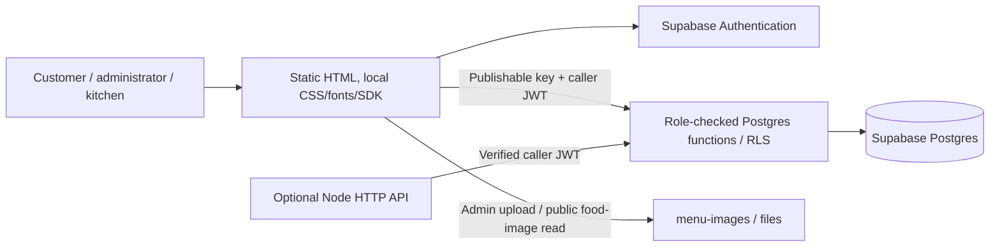
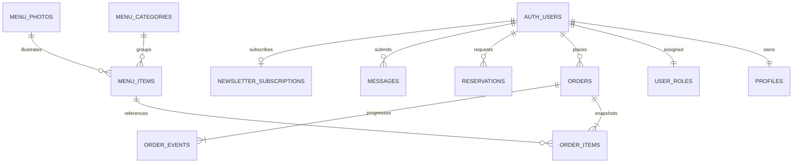

# Architecture

BitesBro is a vanilla HTML/CSS/ES-module food-ordering application. Supabase supplies email/password authentication, Postgres and Storage when configured. The same frontend works on GitHub Pages or the optional Node.js 24 host. The established customer, admin and kitchen layouts are retained.



## Source layout

```text
public/
  index.html, app.js, styles.css, recommendations.js  Existing food website
  auth/                    Sign-in, signup and recovery
  auth.css                 Account styles and pending-access visibility
  admin/, kitchen/, orders/ Protected operational views and own-order tracking
  shared/cloud.js          Runtime config, SDK client, auth, guards and RPC adapter
  shared/session-scope.js  Customer/admin/kitchen session selection and storage keys
  shared/cloud-store.js    In-memory operational state; authenticated polling
  shared/order-history.js  Pure recent-history window for demo/older-server presentation
  shared/customer-nav.js   Shared desktop/mobile customer navbar behaviour
  shared/customer-nav.css  Responsive customer navbar/account and bag presentation
  shared/bag.js            Validated, selection-only bag storage shared by customer pages
  shared/customer-bag.js    Secondary-page bag drawer; returns to the full menu checkout
  shared/customer-page.js   Public photo-credit navigation/account bootstrap
  shared/payments.js        Optional YouPI checkout and customer payment tracking
  shared/payments-admin.js  Administrator bank-receipt/cash/refund recording
  orders/history.css       Customer-facing recent-order cards and progress layout
  shared/photo-upload.js   Verified, resumable administrator upload
  shared/ui.js, operations.js  Shared rendering and controllers
  shared/demo-*.js          Opt-in fictional local preview / pure helpers
  assets/, photo-credits.*  Self-hosted licensed food photos, fonts, visible credits
server/
  index.js, app.js          Optional HTTP lifecycle, static serving, request security
  cloud-config.js          Public settings allowlist; reject secret keys
  cloud-api.js             JWT-verified forwarding to role-checked RPCs
  supabase-client.js       Nonpersistent command-line/readiness client
  database.js, schema.sql, migrations*  Retained SQLite preview / safe forward upgrades
scripts/
  build-client.js          Copy official local SDK; generate ignored public config
  build-pages.js           Build subpath-safe static frontend
  prepare-supabase.js      Generate schema + menu-only seed SQL
  check-supabase.js         Read-only Auth connectivity
  verify-supabase.js        Read-only schema/bucket/anonymous-access readiness
  upload-menu-photos.js    Interactive admin upload; hidden password input
supabase/
  migrations/001_bitesbro.sql, 002_catalogue.sql
  setup.sql                Combined owner-run migration
  bootstrap-admin.sql      Confirmed admin@bitesbro.com role only
  migrations/006_guest_checkout.sql   Private guest Auth ordering
  migrations/007_order_history_delivery.sql  History visibility and manual delivery tracking
  migrations/008_youpi_payments.sql  Forward-only payment state, RLS and kitchen gates
  functions/payments/       Server-only YouPI orchestration and signed webhooks
review/, scripts/build-payment-review.js  Isolated PostgreSQL payment demo for Pages
  tests/security.sql       Rollback-only actual Postgres/RLS checks
```

## Authentication and access

The browser receives only a public project URL and publishable key through generated `supabase-config.json`. The official SDK is copied locally from the locked dependency. Secret/service-role keys are rejected by configuration validation. No management credential is needed at runtime or in Actions.

Signup creates a profile and a `customer` role through an Auth trigger, ignoring user-editable role metadata. `public.my_role()` looks up the protected role for a confirmed, unbanned user. Page guards redirect customers to the customer site, chefs to kitchen, and administrators to admin; admin can also use kitchen. Public menu browsing remains available. Staff role changes are administrator-only and rechecked after locking; clients cannot alter their own role.

After forward migration 006 and enabling Anonymous Sign-Ins, guests can order without an email signup/password. The SDK creates a guest session only on checkout submission; existing order RLS uses its private Auth UUID. `my_role()` permits a guest only when the protected role is customer. Staff roles require a confirmed, non-guest Auth account. Guest order contact emails are validated but unverified, and do not link accounts or order history. Other customer forms retain their confirmed-account rule. [Guest activation and verification](guest-checkout.md).

All application tables enable RLS. Customer reads are restricted by authenticated owner ID. Chef views use a checked ticket projection without name/email/phone/address/postcode fields. Administrators can read operational records. Clients have no direct writes to orders, events, roles, settings or menu. Definer functions use an empty search path, qualified references and explicit execution grants. PostgreSQL default PUBLIC execution is revoked. The SQL and field table in [Supabase setup](supabase.md) are authoritative.

Pages serves public HTML shells; route guards control application navigation and RLS protects data/actions independently. Supplying `?demo=1`, forging metadata or calling REST directly does not grant staff access. Real data is held in memory and Supabase, not in the fictional browser store. Protected views hide on logout/back navigation and reload persisted pages before displaying records.

Customer, administrator and kitchen pages use independent SDK sessions, so staff login/logout cannot replace a guest's identity or sign out another portal. Same-portal tabs continue to synchronise logout. Credential checks use an in-memory probe and a database role check before persisting the permitted destination session. The original customer SDK key is retained; verified legacy staff sessions migrate once without resetting order data. Auth email callbacks retain the existing `/auth/` URL. See [portal-session operation and verification](portal-sessions.md).

## Data and consistency



Money is integer paise. `place_order` checks the customer role, consent, verified account email, contact fields, Bangalore date/time, fulfilment, availability, portions, spice, add-ons and bounded quantities. It locks menu/settings rows, recalculates all amounts and delivery fees, and saves line snapshots/events atomically. A caller/user-scoped request UUID makes retries idempotent. Supplied prices, totals and role fields are ignored.

Order transitions lock rows and verify role/ownership. Customers can cancel only their received orders. Chefs progress one step at a time; administrators can also cancel received/preparing orders. Terminal orders cannot reopen. Reservation capacity and inserts share one locked transaction; sittings never overlap or span the afternoon closure. All date calculations use Asia/Kolkata.

Settings and all operational data persist in Postgres and work across devices. Dashboards poll every eight seconds and customer menus every fifteen seconds; no Realtime publication is required. The optional YouPI adapter is gated by version 8, an explicit public UI flag, server configuration and restaurant preference. Manual UPI requires administrator bank verification before chef release. The separately built `/review/` demo uses real PostgreSQL and the same handler with simulated Auth/YouPI; production credentials and orders never enter it. Automatic courier dispatch and order-confirmation email remain unconnected. See [payment activation and verification boundaries](payments.md).

Forward migration 007 adds owner-scoped `get_order_history`: guests receive three recent orders plus older active orders, while members receive five per page and can search/retrieve earlier records. RLS also denies hidden completed guest records, including line/event reads. Staff records are never deleted. `delivery_assignments`/`delivery_events` track manual administrator dispatch and arrival, while canonical kitchen statuses remain compatible with existing reports. No courier is booked. Checkout redirects to history and customer tracking refreshes from Supabase. See [order-history activation and limits](order-history.md).

## Images and builds

The initial seed preserves 50 menu rows and full provenance for 40 local licensed JPEGs. An administrator uploads verified source bytes to `menu-images/files/<id>-<hash>.jpg`, then a checked RPC registers the existing object. Existing files must match the source hash; they are never overwritten or deleted. The bucket allows public food-image reads and administrator inserts only. Full licence/source/hash metadata, reference labels and the visible photo-credit page remain intact. Until upload, local images continue working.

The Pages builder exports sample menu data from an isolated in-memory SQLite catalogue, copies `public/`, adds the local SDK/public configuration and fixes repository-subpath HTML/CSS/SEO URLs. Never export customer records. Actions installs locked dependencies and obtains only the two public configuration variables. SQL migration is owner-run, not automatic on deployment.

## Optional Node server and local preview

In Supabase mode, Node does not open/write SQLite. It serves files from `public/` using traversal/realpath protections and forwards API operations with the caller JWT. Writes preserve 16 KB JSON limits, origin checks and direct-IP rate limits. The SDK/database also enforce auth on direct browser RPCs. CSP allows local assets plus the configured Supabase connection and public menu-image origins; framing is denied. Health checks query actual Cloud schema readiness.

Without Supabase settings, the earlier Node/SQLite preview remains available. `APP_DEMO_MODE=true` explicitly enables the fictional customer/kitchen/admin browser workflow; it is always disabled when Cloud is configured. The original SQLite baseline and safe version-2 food/version-3 photo migrations retain owner edits and create consistent backups with `VACUUM INTO`. SQLite files are never deleted/reset for the Cloud migration. A Cloud failure does not switch the application to SQLite or fictional writes.

Local SQLite deployment needs one Node instance and persistent disk. Supabase mode supports the static frontend without that disk. Logs, credentials, local databases, build artifacts and customer exports stay ignored. Real business contacts, prices/recipes, fulfilment readiness and a retention policy remain owner inputs.

## Verification boundaries

Node tests cover the legacy API and authenticated proxy/configuration. PGlite executes actual PostgreSQL migrations, functions, RLS and rollback-only security tests with stand-in Auth/Storage schemas. Browser tests exercise the real SDK's signup/login/role navigation, checkout, tracking and 40-photo upload against fixture services, alongside the existing responsive workflows. Separate read-only Cloud checks verify connectivity and applied schema/bucket readiness. Passing local checks does not mean the owner-run Cloud SQL or uploads have happened.
