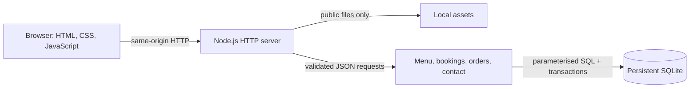
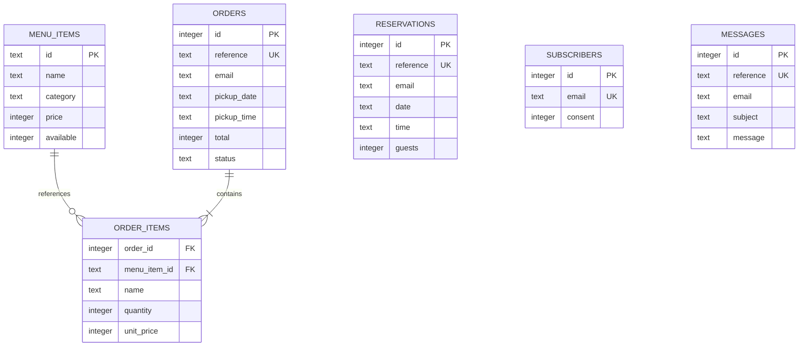

# Architecture

BitesBro is a food-ordering application with South Indian, Indian and global dishes. It is a same-origin web application with no runtime npm dependencies. Node.js 24+ serves the frontend and JSON API; its built-in `node:sqlite` connects directly to a persistent SQLite file. This makes the development workflow reproducible without credentials or separate infrastructure.

```text
Cafe_Website/
├── AGENTS.md                 Agent-discovery entry point
├── agents.md                 Full development instructions
├── readme.md                 Run, test, configure, deploy
├── design_system.md          Visual and interaction system
├── .env.example              Non-secret runtime settings
├── package.json
├── package-lock.json
├── playwright.config.js      Isolated full-stack browser runner
├── docs/
│   ├── architecture.md
│   └── credits.md
├── public/                   Only directory exposed by HTTP
│   ├── index.html            Semantic page, forms, native dialogs
│   ├── styles.css            Tokens, responsive components, reduced motion
│   ├── app.js                API client, menu, bag, forms, enhancements
│   ├── robots.txt
│   ├── sitemap.xml
│   └── assets/
│       ├── favicon.svg
│       ├── icons.svg         Original SVG symbol library
│       ├── fonts/            Self-hosted WOFF2 + licenses
│       └── images/           Photos, original product illustrations, credits
├── server/
│   ├── index.js              Configuration, HTTP lifecycle, graceful shutdown
│   ├── app.js                Routing, security, validation, business operations
│   ├── cafe.js               Business facts, hours, booking-slot derivation
│   ├── database.js           SQLite connection, schema, first-run seed
│   ├── schema.sql            Tables, constraints, indexes, schema version
│   ├── menu.js               Legacy eight-product baseline
│   ├── food-menu.js          Food catalogue, categories and public read model
│   ├── migrations.js         Versioned upgrade runner and consistent backup
│   └── migrations/           002_food_ordering.sql
├── tests/
│   ├── api.test.js           HTTP + SQLite integration tests
│   └── browser.spec.js       Chromium user journeys + responsive checks
└── data/                     Generated and ignored; mount persistently
    └── bitesbro.sqlite       Plus SQLite WAL/SHM files during operation
```

## Request flow



Static paths are resolved and checked against the public directory, including realpath checks so symlinks cannot escape it. The server injects the configured site origin into canonical/social metadata, `robots.txt`, and `sitemap.xml`. The single-page sitemap lists the canonical document once; fragment sections are not separate pages.

The browser loads the menu and café clock from the API. The browser reads the live catalogue once; cuisine/diet/search/price filters and pagination operate on it. The API also supports category, diet and query filters. The bag stores dish IDs, quantities, variant/add-on IDs and spice preferences in local storage. At checkout, the server rereads prices and availability rather than trusting client values.

## Data model



Customer names, phones, consent, notes and creation timestamps are also recorded where appropriate; see `schema.sql` for the authoritative fields. Newsletter addresses are normalised and deduplicated. Reservation email/date/time is unique. Order items retain the name and price at the time of the request. Money is stored in integer paise, never floating point.

## Consistency and operations

- SQLite opens with foreign keys, WAL mode, and a busy timeout. The initial schema is idempotent and seeds only an empty menu table. The version-1 baseline is followed by the version-2 food migration. Existing file databases get a SQLite-aware `VACUUM INTO` backup before the atomic upgrade. The constrained menu table is rebuilt while preserving IDs, names, prices, descriptions, availability and order foreign keys; new dishes are inserted once. Existing order totals and snapshots are preserved. Foreign keys are checked before commit and re-enabled afterwards.
- A booking validates a real calendar date against the café's timezone, a future published slot, guest count, contact details, and consent. `BEGIN IMMEDIATE` wraps the capacity check and insert. Capacity is per non-overlapping 90-minute sitting; the afternoon closure is excluded.
- Food ordering validates IDs, availability, bounded quantities, portion/add-on IDs, spice levels and a future half-hour slot. Delivery also validates an address and Bangalore 560xxx postcode. The total combines database prices, option surcharges and the configured delivery fee/free-delivery threshold. Order and line inserts commit atomically. No money moves through this application.
- The server accepts JSON objects only, enforces a 16KB body limit, checks request origin, and rate-limits anonymous writes by direct client IP. It trusts no forwarded headers by default. CSP restricts resources to the same origin; framing is denied.
- References are cryptographically random. No public GET endpoint returns orders, reservations, messages, or subscriber lists. A future staff interface requires authentication and explicit authorisation.
- `SIGINT`/`SIGTERM` drain requests and close SQLite. A health request executes a real database query rather than returning a static “up.”

## Boundaries

This implementation is appropriate for a single Node.js instance and persistent local disk. It is not a horizontally distributed database design. Rate-limit state is process-local and resets on restart. Deploy HTTPS at a reverse proxy, put client-IP abuse controls there, and back up the database through a SQLite-aware backup operation.

Email sending, online payments, real map directions, staff authentication, cancellation flows, and automated request fulfilment are not integrated. Current forms save demo requests and disclose that status. Do not expose SQL files or customer data to add an admin convenience endpoint. Address, contact details, actual menu, and retention/fulfilment rules remain business inputs before a live launch.

## Food model and static deployment

`menu_items.details` contains the sample recipe/ingredients, diet, allergens, cuisine, portion, preparation estimate, spice preference, variants and add-ons. Base prices and availability remain ordinary columns. `order_items.options` stores the selected variant, spice and add-on price/name snapshots. Orders include fulfilment, optional delivery address/postcode, instructions, food subtotal and delivery fee. There are no public customer-list routes.

`public/menu.json` is exported from a fresh in-memory sample database, never a live customer database. If the API is unavailable, the browser explicitly enters sample/browse-only mode, renders this catalogue and disables order/contact/reservation/newsletter submission. `scripts/build-pages.js` creates `_site/`, substitutes the public Pages origin and prefixes static HTML/CSS assets for the repository path. JavaScript resolves dynamic images relative to the document. The GitHub Actions workflow uses Node.js 24 to build these files. Full database-backed functionality runs on the Node host; GitHub Pages provides a food-catalogue preview.
