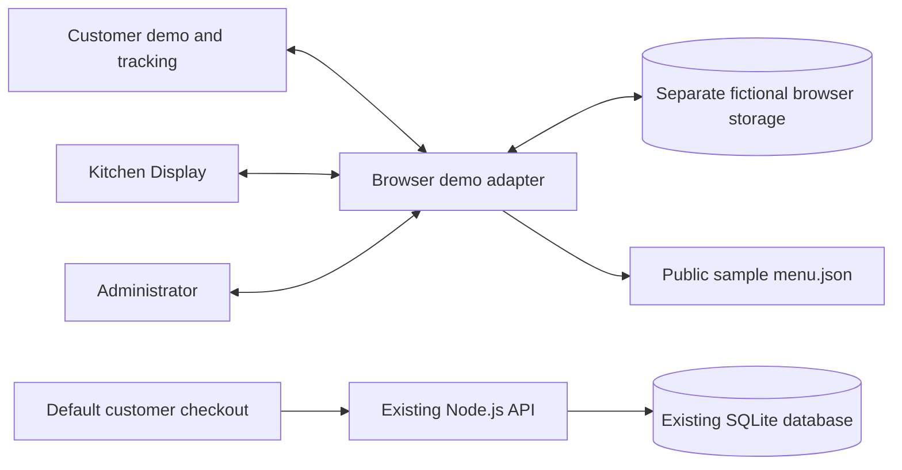

# Three-role BitesBro demonstration

This milestone adds a connected customer, kitchen and administrator demonstration to the existing vanilla HTML/CSS/JavaScript application. It preserves Node.js 24, `node:sqlite`, the complete sample menu and the established ivory/forest/terracotta design system. No production operational API is added.

## Repository audit and implementation plan

The stable starting point was commit `c2fe69c` in `Marykamalaperli/Cafe_Website`, with a clean working tree. Work is isolated on `feat/three-role-demo`.

The audit covered agent instructions, the design system, architecture/deployment documentation, existing customer HTML/CSS/JavaScript, recommendations, the HTTP server, SQLite schema and migrations, business settings, the 50-dish catalogue, photograph provenance, Pages builder/workflow and existing integration/browser tests.

The existing checkout already supported cuisine/diet/search/price filtering, portions/spice/add-ons, persisted bags, API-backed pickup/delivery requests, reservations/contact/newsletter, Bangalore-time recommendations and local licensed food photographs. GitHub Pages was a sample catalogue with disabled server forms. The server's canonical statuses were `received`, `preparing`, `ready`, `collected`, `cancelled`.

The plan was to retain that customer flow, add a separate fictional browser adapter, build kitchen/admin/tracking pages using shared modules, connect customer demo checkout, extend static-path handling, then verify complete workflows and responsive layouts. The implementation follows that plan without a framework migration or a second repository.

## Open the demonstration

Run `npm ci`, then `npm run dev`, from the repository root. On the local Node origin, or the built Pages origin, open:

| Experience | Relative URL |
| --- | --- |
| Existing customer site and connected API checkout | `./` |
| Customer browser demo | `./?demo=1` |
| Kitchen Display System | `./kitchen/` |
| Administrator | `./admin/` |
| Tracking and fictional history | `./orders/` |
| A particular fictional order | `./orders/?order=BB-DEMO-1007` |

On GitHub Pages these paths are below `/Cafe_Website/`. Each nested page can be opened or refreshed directly. The role navigation makes the fictional nature of every operational view explicit: **Demo Mode — No real orders or payments.** Choosing a role is not authentication.

1. Open Customer, Kitchen Display and Administrator in tabs in the same browser.
2. Add a dish with any valid portion/spice/add-on choices.
3. Open the bag, select **Demo checkout**, choose fictional fulfilment and a preset preparation note, then place the demo order.
4. Follow the tracking link. The new ticket also appears in the kitchen and administrator views.
5. In the kitchen, select **Start preparing**, **Mark ready**, then **Mark collected**. Tracking, counts, history and simulated sales update in the other tabs.
6. Edit a demonstration price or toggle a dish's availability in Menu. The customer menu and kitchen availability reflect it. Existing order snapshots retain their original names and prices.
7. Administrator → Settings can pause new demo checkout or reset only the fictional store.

The kitchen can be simulated outside the restaurant's actual opening periods. The UI continues to show the supplied real hours, 10am–3pm and 6pm–11pm, separately from the demo acceptance setting. Recommendations still use Bangalore time.

## Shared architecture

`public/shared/demo-model.js` owns deterministic seed records, order calculations, allowed transitions, menu edits, reports and validation. It has no DOM or network dependency and is tested directly with isolated in-memory storage.

`public/shared/demo-store.js` loads only the public sample catalogue, uses the versioned `bitesbro.demo.v1` local-storage namespace, and subscribes to same-origin `storage` events. Where supported, Web Locks serialize mutations across tabs. Browsers without Web Locks use a best-effort local-storage fallback; simultaneous edits in those older browsers can conflict. This adapter is for demonstration, not concurrent production operations.

`public/shared/ui.js` and `operations.js` share role navigation, local dates, status labels, item/option snapshots, accessible dialogs, timelines and feedback. The customer retains its established UI and uses the adapter only after explicit demo selection. Each operational page has a dedicated entry module and common `operations.css` extending the existing brand tokens and fonts.

## Fictional data and calculations

- Initial data retains all 50 dishes and eight categories, plus six predictable tickets `BB-DEMO-1001`–`BB-DEMO-1006` covering all statuses. Sample timestamps are relative to the demonstration's start time; all are labelled fictional.
- New references are sequential `BB-DEMO-1007`, etc. Bag quantities, portion IDs, spice and add-on choices are validated against the current demo menu. Subtotals and totals are recomputed in integer paise; supplied totals are ignored.
- Demonstration delivery uses the existing sample ₹40 fee, waived from ₹499. No delivery address is requested or stored.
- Order lines snapshot food names, quantities, image paths, portion/add-on labels and prices. Subsequent menu edits do not change historical tickets.
- Customers can cancel their own Received demo ticket. Kitchen actions advance one step at a time: Received → Preparing → Ready → Collected. Administrator actions can also cancel Received or Preparing tickets. Terminal orders cannot be reopened.
- Menu editing supports names, descriptions, prices, category, diet, preparation estimates, ingredients/allergens and existing licensed reference photographs. Items can be added, paused, archived and restored. Recipes and servings remain samples.
- Total-order/status counts include every fictional ticket. Simulated sales include collected orders only, including any demonstration delivery fee; cancelled orders contribute no sales. Popular-item quantities exclude cancelled orders. Daily summaries group by order creation date in Bangalore time and include seven calendar days. No chart presents real business performance.
- The store is bounded to 200 dishes, 250 orders and 100 recent activity entries. Reset restores sample data without clearing the existing bag or unrelated browser keys.

## Privacy, failure handling and boundaries

Demo checkout is a separate form. It never reads the connected order form's name, email, phone, address, postcode or instructions. Identity is always the fixed fictional label **Demo guest**. Preparation notes are selected from a small fixed list rather than free text. Persistence constructs allowed order fields and rejects contact/payment keys in saved demo state.

Demo mode disables the existing server-write forms. Leaving it restores the existing connected API experience on a Node host. On Pages, those real forms remain unavailable; only the separate fictional checkout runs. No demo order is transmitted to Node or SQLite.

All editable text is escaped before rendering. Menu image choices are limited to existing local credited photographs. Storage failures show an error rather than a false success; damaged data offers retry/reset. The UI does not silently erase a damaged demonstration store.

The browser store is editable by its user and is never a security boundary. Role navigation provides no privileges, and cross-tab synchronization is limited to the same browser profile and origin. Different devices, private windows and origins do not share it. No payment, real kitchen dispatch, staff login, email or production reporting is connected.

## GitHub Pages build

`npm run build:pages` continues to produce `_site/`. It exports the sample menu from an isolated in-memory database, regenerates photo attribution, copies all static pages and rewrites absolute HTML/CSS asset paths for the configured repository subpath. Shared JavaScript resolves URLs relative to its own module, so nested pages use the correct base. There is no Vite build and no backend requirement for the fictional demo.

The existing `.github/workflows/deploy.yml` remains the single deployment workflow. It has not been triggered for this milestone; changes remain on the local feature branch for review. The Node static-file handler now serves directory `index.html` files with the existing realpath checks and security headers; this exposes only public demonstration pages, not staff/customer APIs.

## Secure live backend expansion

Before connecting real operations, implement and review:

1. **Staff identity:** individual staff accounts, secure password hashing or a trusted identity provider, HTTPS-only sessions, secure/HttpOnly/SameSite cookies, session rotation and revocation. Never store staff tokens in demo storage.
2. **Server-side permissions:** authenticated, deny-by-default administrator and kitchen roles on every operational request. The browser's selected role must never grant access.
3. **Restricted retrieval:** authenticated kitchen queues with only necessary preparation information; administrator views with explicit permissions; customer tracking through a verified account or scoped private token. Keep public unauthenticated customer lists unavailable.
4. **Validated mutations:** server-calculated totals, atomic conditional status transitions, authenticated menu mutations, CSRF protection for cookie sessions, input validation and bounded request bodies. Add forward SQLite migrations only when required; preserve backups and existing history.
5. **Audit and operations:** append-only actor/action/time records, meaningful API/integration tests for every role and denied access, per-client abuse controls, monitored HTTPS hosting, durable disks, SQLite-aware backups, retention rules and operational recovery.
6. **Real reporting:** permission-checked server queries using actual fulfilment/payment policy, with cancellations/refunds and date definitions agreed before publishing numbers.

No insecure placeholder login, public order-management endpoint or administrative SQL access is included in this frontend milestone.

## Business and review inputs still needed

Confirm the actual address/contact details, final dishes/prices/recipes/allergens and licensed photographs of actual servings. Daily opening, delivery areas/fees, staffing, fulfilment/cancellation practices and privacy/retention policy remain editable assumptions. Real payments, messages and delivery providers need intentional integrations. Review this branch before merging, pushing or deploying it.
